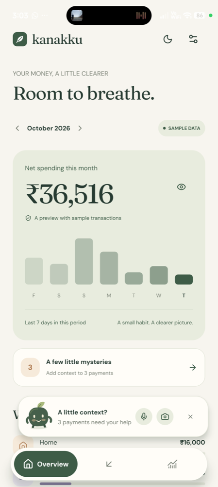
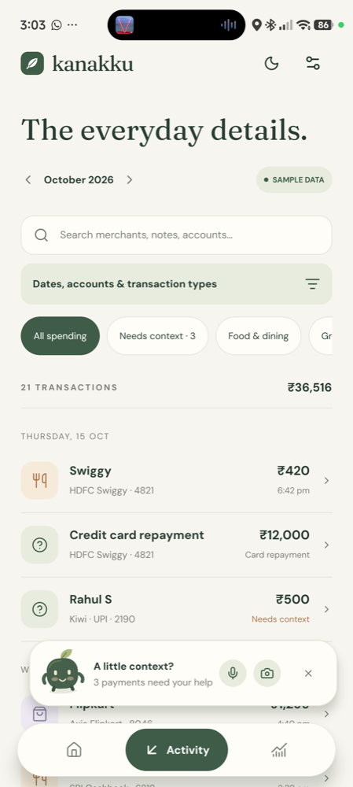
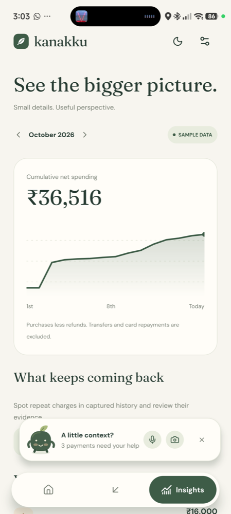
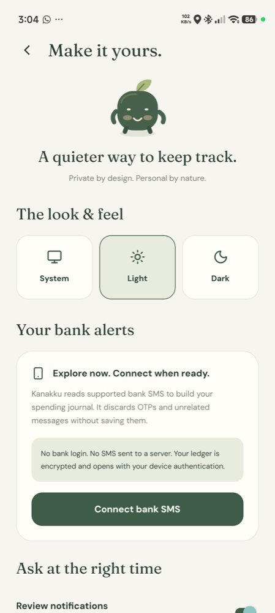

<p align="center">
  
</p>

<h1 align="center">Kanakku</h1>

<p align="center">
  Your bank SMS, turned into a private spend journal.<br>
  <strong>Nothing leaves your phone.</strong>
</p>

<p align="center">
  <a href="https://github.com/AnanthuTD/kanakku/actions/workflows/regression.yml"></a>
  <a href="https://github.com/AnanthuTD/kanakku/releases/latest"></a>
  <a href="LICENSE"></a>
  
</p>

<p align="center">
  
  
  
  
</p>

Indian banks text you every time money moves. Kanakku reads those alerts on the phone, keeps an encrypted journal of what you actually spent, and asks — in its own words — only when a payment needs context. No account, no server, no ads, no analytics.

## Why you can trust it

Every claim below is in the source, and most are covered by tests.

- **Offline by design.** The app makes no network calls on its own. The only two are opt-in and visible: a merchant lookup you approve per search (a public business name, nothing else), and the manual _Check for updates_ button in Settings.
- **Raw SMS is never stored.** Each alert is parsed and discarded; only the extracted payment fields are kept. OTPs and anything unrelated are rejected before they reach storage.
- **The journal is encrypted at rest** with SQLCipher. Its key lives in the Android Keystore and is gated by your device lock. Alerts that arrive while the phone is locked are sealed into an encrypted inbox and only opened after you unlock.
- **Voice and bill photos are processed on-device.** Speech goes through a bundled Whisper model; bills through a bundled ML Kit text recogniser. Audio is held briefly in memory and never written to storage. OCR text and photos are not persisted.
- **Money is integer paise** and every total is computed from the ledger on demand. Refunds subtract; transfers, income, cash and card repayments never inflate spending.
- **Your corrections win.** Original values, classifier provenance and your edits are all kept; nothing you confirmed is overwritten by a suggestion.
- **Releases are reproducible.** Every APK on the [Releases](https://github.com/AnanthuTD/kanakku/releases) page is built by a public GitHub Actions workflow from the tagged commit, signed with the project's release key, and published with `SHA256SUMS` and the signing certificate fingerprint.

The beta also keeps a small diagnostics log on the phone (stages, counts and timings — no message text, amounts, names or images). It stays on your device; nothing uploads it. You can turn it off or clear it in Settings, and attach it to a bug report if you choose.

See [SECURITY.md](SECURITY.md) for the full policy and how to report a problem privately.

## What it does

- **Imports your history** over a window you choose (1–12 months or everything), recent days first, in the background, with pause and resume.
- **Catches new payments** as they arrive and files the clear ones automatically.
- **Asks about the unclear ones** through a small companion: tap it and say what the payment was for, or type, or photograph the bill. A floating version can appear over other apps if you allow it — it listens when tapped and never records on its own.
- **Reads bills.** A photo becomes editable line items, taxes, discounts, service charge and total, checked against the printed amounts. Tested against real Indian receipts, from restaurant bills to weighed produce and an electricity bill.
- **Finds what repeats.** Likely subscriptions and recurring bills are surfaced as suggestions with their evidence — labels you confirm, never guesses about enrolment or due dates.
- **Answers questions.** "Food last two months", "total last month", an exact merchant and period — every answer opens the rows behind it.
- **Looks after itself.** Ivory-and-forest light theme, charcoal-and-green dark theme, reduced-motion and silent-mode aware, keyboard and screen-reader journeys tested.

## Install

1. Download the latest APK from [Releases](https://github.com/AnanthuTD/kanakku/releases/latest). Android 12 or newer, arm64.
2. Verify it. On a computer:
   ```sh
   shasum -a 256 kanakku-*.apk      # must match SHA256SUMS from the release
   apksigner verify --print-certs kanakku-*.apk   # must match SIGNING-CERTIFICATE.txt
   ```
3. Open the APK on the phone and allow installing from that source.
4. In Kanakku, go to Settings → **Connect bank SMS**, choose how far back to import, and grant **SMS** and **Notifications**. Microphone, camera and _display over other apps_ are each optional and only asked for when you use the feature.
5. A screen lock must be set — it protects the journal key.

On Xiaomi/HyperOS phones, also allow _Autostart_ and set battery saver to _No restrictions_ so background import and alert capture keep running.

## Build it yourself

Node 24, JDK 17, Android SDK 36 (platform, build-tools 36.0.0, NDK 27.1, CMake 3.22) and Kotlin 2.2.20+.

```sh
npm ci
npm run models:fetch            # downloads the two bundled ML models and verifies their hashes
npx expo prebuild --platform android --no-install
(cd android && ./gradlew :app:assembleRelease -PreactNativeArchitectures=arm64-v8a --max-workers=4)
node scripts/verify-apk.mjs android/app/build/outputs/apk/release/app-release.apk
```

A local build is signed with the development key; set the four `KANAKKU_RELEASE_*` environment variables to sign with your own keystore. `npm run web` runs a browser preview with sample data (the native features need the Android build and say so rather than pretending).

The full regression — TypeScript, unit tests, dependency checks, standalone Kotlin parser checks and Playwright browser journeys — is one command:

```sh
npm run test:regression
```

## What is still unverified

Kanakku is a personal beta. Honest gaps, all tracked in [CHECKLIST.md](CHECKLIST.md):

- Bank SMS formats are covered by real fixtures for the banks the author uses plus synthetic ones for others; yours may need a parser addition (please open an issue with a redacted sample).
- Voice accuracy has been checked on one phone with English; Malayalam is planned as an installable language pack.
- Bill reading is tested on nine real receipts; crumpled or low-light photos degrade.
- Hardware-backed key storage depends on the device; the app cannot protect data on a rooted phone.

## Contributing

Issues and pull requests are welcome — bank formats and receipt layouts that mis-parse are the most useful things you can send. Read [CONTRIBUTING.md](CONTRIBUTING.md) first: it has the setup, the test commands and the few privacy rules every change must respect.

## Licence

[MIT](LICENSE). Bundled models: Whisper (MIT), all-MiniLM-L6-v2 (Apache 2.0); their notices ship inside the app.
